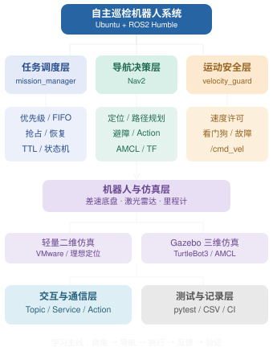

# 一、项目功能

**基于 ROS2 的移动机器人自主巡检与事件响应系统**

先运行整套系统，再通过改参数和注入事件理解它。目标环境是 **Ubuntu 22.04 + ROS2 Humble**；轻量模式适合 VMware，Gazebo 模式复用 TurtleBot3 Burger。

已实现：多点巡逻、事件优先队列、同级 FIFO、嵌套抢占、明确取消后再派发、处置计时、未完成巡逻恢复、进程内去重、排队 TTL、有限重试、导航/取消期限、暂停、故障锁存、速度看门狗、CSV 记录、指标汇总、网页控制台和测试入口。

| 模式 | 用途 | 导航与定位 |
|---|---|---|
| Windows 本机预览 | 现在体验插队、恢复、队列和异常，无需 ROS2 | 同一份 C++ 调度核心 + 简化 A*，不作为 Nav2 验收 |
| ROS2 轻量仿真（默认） | VMware 中运行完整消息链与真实导航 | 真正的 Nav2 + 二维差速底盘/激光，理想定位 |
| ROS2 Gazebo | 观察模型、物理碰撞、激光和定位误差 | 真正的 Nav2 + TurtleBot3 + Gazebo Classic + AMCL |

**系统模块如何配合**

```text
网页 / ROS2 Incident 消息
          ↓
mission_manager（C++：优先级、状态机、取消、恢复）
          ↓ NavigateToPose action
Nav2（规划、局部控制、恢复行为）
          ↓ /nav_cmd_vel
velocity_guard（许可 + 指令/里程计/激光新鲜度）
          ↓ /cmd_vel（唯一底盘速度出口）
轻量底盘 或 TurtleBot3/Gazebo
          ↓ /odom、/scan、TF
Nav2 + 任务管理器 + 网页/RViz
```

`mission.hpp` 定义任务规则；`mission_node.cpp` 把 ROS 回调接到规则上。高优先级事件到达后，先禁止运动并取消旧目标，收到旧目标终结结果才发新目标。巡逻索引仅在到达并停留完成后前进，因而能恢复未完成巡逻。事件处置目前是模拟停留。

| 入口 | 作用 |
|---|---|
| `src/patrol_interfaces/msg/Incident.msg` | 事件 ID、优先级、目标、TTL 和处置时间 |
| `src/patrol_manager/include/patrol_manager/mission.hpp` | 可独立编译测试的 C++ 任务核心 |
| `src/patrol_manager/src/mission_node.cpp` | ROS action、话题、服务、健康与审计 |
| `src/patrol_sim/patrol_sim/` | 仿真、速度保护、网页接口 |
| `src/patrol_bringup/config/mission.yaml` | 巡逻与任务参数，适合从这里改起 |
| `src/patrol_bringup/config/nav2.yaml` | 基于上游 Humble 快照派生的导航参数 |
| [基于ROS2的移动机器人自主巡检与事件响应系统](docs/基于ROS2的移动机器人自主巡检与事件响应系统.md) | 系统学习笔记：观察巡逻运行，理解节点、话题、服务和动作 |
| [ROS2环境配置humble](docs/ROS2环境配置humble.md) | 当前 Humble 运行环境、安装与启动命令速查 |
| [实验菜单](docs/EXPERIMENTS.md) | 改什么、出现什么效果、怎样验证 |
| [设计与接口](docs/ARCHITECTURE.md) | 状态、话题、恢复和计时约定 |
| [验证记录](docs/VALIDATION.md) | 已验证内容与待 Ubuntu 验证的边界 |

# 二、运行操作

## 2.1 windows

双击 **`启动本机预览.cmd`**，或在本目录执行：

```powershell
python tools\desktop_demo.py
```

自动打开 [本机控制台](http://127.0.0.1:8765)。交付包含 Windows x64 的本机编译产物；源码更新后会重新编译，需要 `g++`、`clang++` 或 `zig`。其他机器运行 `python tools/build_core.py` 重新构建。预览只需要 Python 标准库，测试/资产生成另外需要 pytest/PyYAML。

在地图上点选位置，发一个优先级 20 的警报，随后点“紧急插队 · 100”。观察先处理 100、恢复 20、再返回原巡逻点。终端运行时用 `Ctrl+C` 关闭，后台预览可双击 `停止本机预览.cmd`。重复启动会打开已有控制台。

## 2.2 Linux

### 2.2.1 安装与启动

先按 [Humble 环境说明](docs/ENVIRONMENT.md) 安装 Ubuntu 22.04 和 ROS2 Humble。将**整个 `patrol_robot_ws` 目录**复制到 Ubuntu（不只复制 `src`）。以下使用当前实际路径 `~/patrol_robot_ws`；目录不同则相应替换。不用复制 Windows 产物、`.cache`、`build/install/log`。

```bash
cd ~/patrol_robot_ws
bash scripts/setup_ubuntu.sh
bash scripts/run.sh
```

脚本安装依赖、编译并测试，随后启动 Nav2、底盘、C++ 任务管理器、速度门禁、RViz 和网页。**在 Ubuntu 浏览器**打开 [控制台](http://127.0.0.1:8765)。Nav2 生命周期激活后开始巡逻，启动阶段显示 `WAITING` 是正常状态。

**降低虚拟机负担：** 关闭 RViz，保留网页：

```bash
bash scripts/run.sh rviz:=false
```

**Gazebo 模式：**

```bash
bash scripts/setup_ubuntu.sh --gazebo
bash scripts/run.sh backend:=gazebo gui:=false
```

`gui:=false` 保留物理仿真，只关闭 Gazebo 三维窗口；需要三维画面改为 `gui:=true`。此路径面向 Humble/Gazebo Classic。

安装或启动报错时，按第三部分“踩坑”中的对应报错修复。

### 2.2.2 ROS2 命令操控

在另一个已加载 ROS 和 `install/setup.bash` 的 Ubuntu 终端：

```bash
ros2 service call /patrol/set_paused std_srvs/srv/SetBool '{data: true}'
ros2 service call /patrol/set_paused std_srvs/srv/SetBool '{data: false}'
ros2 topic pub --once /patrol/incidents patrol_interfaces/msg/Incident \
  '{id: alarm-001, priority: 80, target: {header: {frame_id: map}, pose: {position: {x: 6.5, y: 6.5}, orientation: {w: 1.0}}}, ttl_sec: 180.0, handling_sec: 3.0}'
ros2 topic echo /patrol/status
```

优先级数值越大越优先，1～100 有效；同 ID 在同一进程期间不再接收。TTL 从本机收到消息起计，只用于等待队列；执行中的导航由目标期限保护。重启从 P1 开始并清空去重历史，当前版本不实现跨重启任务持久化。

### 2.2.3 测试与运行记录

```bash
python3 tools/build_core.py
python3 -m pytest tests -q
colcon test --event-handlers console_direct+
colcon test-result --verbose
```

实际 Nav2 黑盒验收使用 `tools/ros_acceptance.py`，详见实验菜单。CI 在 `.github/workflows/ci.yml`，需将本工作空间作为仓库根目录；本次没有创建远程仓库、推送或运行 GitHub Actions。

ROS 记录默认位于 `~/.ros/patrol_runs/`，预览记录位于 `preview_runs/`。`python3 tools/report_metrics.py records.csv` 汇总派发/到达延迟、完成比例、过期和失败。复用出处、源码快照和许可见 [THIRD_PARTY_NOTICES.md](THIRD_PARTY_NOTICES.md)。

# 三、踩坑

以下记录 2026-11-02 安装和启动中遇到的三个问题。按对应报错选择操作，命令均在 Ubuntu 终端执行；遇到新的错误先停在该步骤。

## 3.1 rosdep init 下载 GitHub 文件时连接重置

报错示例：

```text
ERROR: cannot download default sources list from:
https://raw.githubusercontent.com/ros/rosdistro/master/rosdep/sources.list.d/20-default.list
Connection reset by peer
```

失败发生在依赖数据库初始化阶段，前面的 `fontconfig/libc-bin/man-db` 触发器是正常安装输出。已经完成的 apt 安装可以保留。

将更新后的 `scripts/setup_ubuntu.sh` 同步到 Ubuntu 同名文件，然后切换到镜像模式继续：

```bash
cd ~/patrol_robot_ws
bash scripts/setup_ubuntu.sh --rosdep-mirror
```

需要 Gazebo 则使用：

```bash
bash scripts/setup_ubuntu.sh --rosdep-mirror --gazebo
```

镜像模式同时替换 rosdep 规则地址和 `ROSDISTRO_INDEX_URL`，并保留配置备份。成功标志是规则与 Humble 索引更新完成，末尾没有 `ERROR`，脚本继续到依赖检查和构建。若不方便同步脚本，[网络恢复说明](docs/ROSDEP_NETWORK.md) 中也提供了手动初始化命令。

## 3.2 Humble 已更新，但 fuerte.yaml 下载失败

报错示例：

```text
Add distro "humble"
updated cache in /home/donk/.ros/rosdep/sources.cache
ERROR: unable to process source [.../releases/fuerte.yaml]
ERROR: Not all sources were able to be updated.
```

默认来源列表保留了旧 ROS1 Fuerte 的 `gbpdistro` 条目，本项目不需要它。`--rosdistro humble` 会过滤发行版索引，但仍会读取这个独立来源。仅看到 `updated cache` 还不能认定更新完整成功。

直接备份并注释该条目，再更新；无需重新复制工程：

```bash
sudo sed -i.before-fuerte-fix -E \
  '/^[[:space:]]*gbpdistro[[:space:]].*fuerte[.]yaml([[:space:]]|$)/s/^/# Disabled for Humble: /' \
  /etc/ros/rosdep/sources.list.d/20-default.list

export ROSDISTRO_INDEX_URL=https://mirrors.ustc.edu.cn/rosdistro/index-v4.yaml
rosdep update --rosdistro humble
```

第一条命令留下 `.before-fuerte-fix` 备份。确认更新结束没有 `ERROR`，再继续原安装脚本：

```bash
cd ~/patrol_robot_ws
bash scripts/setup_ubuntu.sh --rosdep-mirror
```

需要 Gazebo 时加 `--gazebo`。更新使用普通用户，运行 `rosdep update` 不要加 `sudo`。新版安装脚本会自动备份并注释该旧条目；现有脚本也会保留上述手动注释。

## 3.3 启动时报 lightweight_sim executable not found

报错示例：

```text
executable 'lightweight_sim' not found on the libexec directory
'/home/donk/patrol_robot_ws/install/patrol_sim/lib/patrol_sim'
```

包已被找到，但启动脚本未被识别为可执行文件。旧交付 ZIP 中三个 Python 入口缺少 Linux 执行位，`--symlink-install` 创建的符号链接不会补上目标文件的执行权限。

为三个入口统一补权限，只重建 `patrol_sim`，无需重装依赖或重新复制工程：

```bash
cd ~/patrol_robot_ws
source /opt/ros/humble/setup.bash

chmod +x src/patrol_sim/scripts/{lightweight_sim,velocity_guard,control_panel}
colcon build --packages-select patrol_sim --symlink-install
source install/setup.bash

ros2 pkg executables patrol_sim
```

构建应成功，最后一条命令应列出以下三项（顺序可以不同）：

```text
patrol_sim control_panel
patrol_sim lightweight_sim
patrol_sim velocity_guard
```

确认入口齐全后启动：

```bash
bash scripts/run.sh
```

如果仍未列出入口，查看安装结果与符号链接：

```bash
ls -l install/patrol_sim/lib/patrol_sim/
```

新版 CMake 会在构建目录生成有执行权限的入口副本，新的 ZIP 也保留脚本执行位。上述检查仅确认入口可识别，Nav2 和仿真的运行结果仍需继续观察。

详细依据与说明：[rosdep 网络恢复](docs/ROSDEP_NETWORK.md)、[启动入口权限修复](docs/LAUNCH_TROUBLESHOOTING.md)。

# 四、知识图谱

## 4.1 项目知识图谱

这张图将整个项目划分为六个模块。先理解模块之间的关系，再学习每个模块内部的知识。

**ROS2 自主巡检机器人 · 知识框架**



## 4.2 新概念逐行解释

### 1. ROS2 基础与通信

- **ROS2**：机器人软件开发框架，让不同节点能够相互通信、协同工作。
- **Node（节点）**：承担某项功能的 ROS2 组件，例如任务管理节点、导航节点；一个进程也可以包含多个节点。
- **Topic（话题）**：发布和订阅消息的通信方式，适合持续传递数据，例如机器人不断发布速度信息。
- **Message（消息）**：ROS2 中传递的数据结构，例如项目中的 `Incident.msg` 表示一条报警事件。
- **Service（服务）**：请求—响应式通信，例如发送暂停请求并接收处理结果。
- **Action（动作）**：适合耗时任务的通信机制，支持目标、进度反馈、结果和取消，例如导航到指定位置。
- **Callback（回调函数）**：收到消息、服务请求或定时器到期等事件后，由执行器调用的函数。
- **Workspace（工作空间）**：存放多个 ROS2 功能包、源码和编译产物的项目目录。
- **colcon**：ROS2 常用的项目构建和测试工具。
- **rosdep**：根据项目依赖声明解析并安装系统依赖的工具。

### 2. 机器人导航与运动

- **Nav2**：ROS2 自主导航框架，负责路径规划、运动控制和导航异常恢复。
- **SLAM**：机器人在未知环境中同时进行地图构建和自身定位的技术；本项目没有将它列为独立运行模块。
- **AMCL**：利用激光雷达、里程计和已有地图估计机器人位置的定位算法。
- **TF / TF2**：管理机器人不同坐标系之间的位置、姿态及变换关系。
- **Odom（里程计）**：估计机器人相对位置、姿态和速度的信息。
- **LiDAR（激光雷达）**：通过激光测距感知周围障碍物的传感器。
- **Differential Drive（差速底盘）**：通过左右轮速度差控制机器人前进和转弯的底盘结构。
- **A*（A 星算法）**：常见的路径搜索算法，本项目 Windows 预览使用简化版 A*。
- **`/cmd_vel`**：向机器人底盘发送线速度和角速度指令的话题。
- **`/scan`**：通常用于发布二维激光雷达扫描数据的话题。
- **`/odom`**：通常用于发布机器人里程计数据的话题。
- **NavigateToPose**：Nav2 提供的 Action 接口，用来要求机器人导航到指定位置。

### 3. C++ 任务调度与事件响应

这是项目中最值得重点学习的一部分。

- **mission_manager（任务管理器）**：负责巡逻任务、事件优先级、任务抢占、取消和恢复。
- **State Machine（状态机）**：用不同状态和状态转换规则管理机器人行为，例如等待、导航和事件处理。
- **Priority Queue（优先队列）**：优先执行重要性更高的任务，例如优先处理高危报警；本项目用容器和排序规则实现，不限定必须使用某个 STL 类型。
- **FIFO（先进先出）**：相同优先级下，先进入队列的事件先处理。
- **Preemption（抢占）**：高优先级任务中断当前任务并优先执行。
- **Nested Preemption（嵌套抢占）**：正在处理紧急事件时，又出现更高优先级事件，允许再次插队。
- **Cancellation（取消）**：向正在执行的导航动作发出取消请求，并等待旧目标的终结结果；取消请求的应答不代表导航已经结束。
- **Resume（恢复）**：紧急事件处理完成后，继续之前尚未完成的巡逻或事件任务；本项目会重新导航，处置计时重新开始。
- **TTL（生存时间）**：事件的有效期；本项目从本机接收时刻起计时，在等待队列中检查过期，过期后不再等待处理。
- **Deduplication（去重）**：防止同一个事件 ID 在当前进程中被重复接收。
- **Retry（重试）**：任务执行失败后，按设定次数重新尝试。
- **Deadline（期限）**：为导航或取消操作设置时间限制，防止无限等待。
- **Fault Latching（故障锁存）**：故障发生后保持故障状态，避免系统在未解除故障时自动恢复。

### 4. 运动安全与运行管理

- **velocity_guard（速度门禁）**：检查运行许可、速度指令与传感器数据状态，决定是否允许速度指令发送到底盘。
- **Watchdog（看门狗）**：持续监测关键输入是否按时更新，例如速度指令长期没有更新时触发保护。
- **Data Freshness（数据新鲜度）**：根据最近接收时间判断速度、里程计和激光数据是否超时；新鲜不等于内容一定正确。
- **ROS2 Lifecycle（生命周期）**：管理节点从未配置、未激活到激活等运行状态。
- **Health Monitoring（健康监测）**：检查节点或关键模块是否处于正常运行状态。

### 5. 仿真与可视化

- **Gazebo**：机器人仿真软件，可以模拟物理碰撞、传感器和机器人运动。
- **Gazebo Classic**：Gazebo 的旧系列，本项目 Humble 三维仿真采用它。
- **TurtleBot3 Burger**：一种常用的差速移动机器人模型，本项目用于 Gazebo 仿真。
- **RViz**：ROS2 可视化工具，可观察地图、机器人位置、传感器和导航路径。
- **Ideal Localization（理想定位）**：仿真直接提供准确位置，简化真实定位中的误差问题。
- **Backend（运行后端）**：负责底层执行的实现方式，本项目 ROS2 系统可选择轻量仿真或 Gazebo。

### 6. 工程开发与测试

- **YAML**：配置文件格式，用于存放巡逻任务和 Nav2 参数。
- **pytest**：Python 自动化测试框架。
- **Unit Test（单元测试）**：独立测试某个功能，例如 C++ 调度核心的任务排序。
- **Black-box Acceptance Test（黑盒验收测试）**：不依赖内部实现细节，通过输入和输出验证系统行为。
- **CSV**：表格数据文件格式，用于记录任务事件和统计数据。
- **Metrics（指标）**：衡量系统效果的数据，例如任务完成率和导航延迟；具体含义以本项目的统计口径为准。
- **CI（持续集成）**：代码变化后自动执行构建、检查和测试的工程流程。
- **GitHub Actions**：GitHub 提供的自动化工作流服务，本工程配置了 CI 文件，但尚未实际运行远程工作流。
